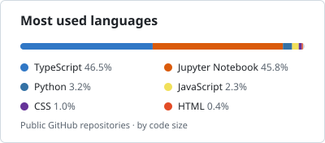

    
  

  <h2 align="center">💻 Tech Stacks</h2>

   

  <h3 align="center">🔠 Language:</h3>
  

    
    
    
    
  

  <h3 align="center">🖼️ Frontend Framework:</h3>
  

    
    
  

  <h3 align="center">🔗 Backend Framework:</h3>
  

    
    
    
  

  <h3 align="center">📔 Full Stack Framework:</h3>
  

    
  

  <h3 align="center">📊 Database:</h3>
  

    
    
    
    
    
    
  

   
   

  <picture>
    <source media="(prefers-color-scheme: dark)" srcset="./assets/top-languages-dark.svg" />
    <source media="(prefers-color-scheme: light)" srcset="./assets/top-languages-light.svg" />
    
  </picture>  

<!-- BEGIN COMMIT ACTIVITY -->

<picture></picture> 
<picture></picture>&#8288;<picture></picture>&#8288;<picture></picture>&#8288;<picture></picture>&#8288;<picture></picture>&#8288;<picture></picture>&#8288;<picture></picture>&#8288;<picture></picture>&#8288;<picture></picture>&#8288;<picture></picture>&#8288;<picture></picture>&#8288;<picture></picture>&#8288;<picture></picture>&#8288;<picture></picture>&#8288;<picture></picture> 
<picture></picture>&#8288;<picture></picture>&#8288;<picture></picture>&#8288;<picture></picture>&#8288;<picture></picture>&#8288;<picture></picture>&#8288;<picture></picture>&#8288;<picture></picture>&#8288;<picture></picture>&#8288;<picture></picture>&#8288;<picture></picture>&#8288;<picture></picture>&#8288;<picture></picture>&#8288;<picture></picture>&#8288;<picture></picture>&#8288;<picture></picture>&#8288;<picture></picture>&#8288;<picture></picture>&#8288;<picture></picture>&#8288;<picture></picture>&#8288;<picture></picture>&#8288;<picture></picture>&#8288;<picture></picture>&#8288;<picture></picture>&#8288;<picture></picture>&#8288;<picture></picture>&#8288;<picture></picture>&#8288;<picture></picture>&#8288;<picture></picture>&#8288;<picture></picture>&#8288;<picture></picture>&#8288;<picture></picture>&#8288;<picture></picture>&#8288;<picture></picture>&#8288;<picture></picture>&#8288;<picture></picture>&#8288;<picture></picture>&#8288;<picture></picture>&#8288;<picture></picture>&#8288;<picture></picture>&#8288;<picture></picture>&#8288;<picture></picture>&#8288;<picture></picture>&#8288;<picture></picture>&#8288;<picture></picture>&#8288;<picture></picture>&#8288;<picture></picture>&#8288;<picture></picture>&#8288;<picture></picture>&#8288;<picture></picture>&#8288;<picture></picture>&#8288;<picture></picture>&#8288;<picture></picture>&#8288;<picture></picture>&#8288;<picture></picture> 
<picture></picture>&#8288;<picture></picture>&#8288;<picture></picture>&#8288;<picture></picture>&#8288;<picture></picture>&#8288;<picture></picture>&#8288;<picture></picture>&#8288;<picture></picture>&#8288;<picture></picture>&#8288;<picture></picture>&#8288;<picture></picture>&#8288;<picture></picture>&#8288;<picture></picture>&#8288;<picture></picture>&#8288;<picture></picture>&#8288;<picture></picture>&#8288;<picture></picture>&#8288;<picture></picture>&#8288;<picture></picture>&#8288;<picture></picture>&#8288;<picture></picture>&#8288;<picture></picture>&#8288;<picture></picture>&#8288;<picture></picture>&#8288;<picture></picture>&#8288;<picture></picture>&#8288;<picture></picture>&#8288;<picture></picture>&#8288;<picture></picture>&#8288;<picture></picture>&#8288;<picture></picture>&#8288;<picture></picture>&#8288;<picture></picture>&#8288;<picture></picture>&#8288;<picture></picture>&#8288;<picture></picture>&#8288;<picture></picture>&#8288;<picture></picture>&#8288;<picture></picture>&#8288;<picture></picture>&#8288;<picture></picture>&#8288;<picture></picture>&#8288;<picture></picture>&#8288;<picture></picture>&#8288;<picture></picture>&#8288;<picture></picture>&#8288;<picture></picture>&#8288;<picture></picture>&#8288;<picture></picture>&#8288;<picture></picture>&#8288;<picture></picture>&#8288;<picture></picture>&#8288;<picture></picture>&#8288;<picture></picture>&#8288;<picture></picture> 
<picture></picture>&#8288;<picture></picture>&#8288;<picture></picture>&#8288;<picture></picture>&#8288;<picture></picture>&#8288;<picture></picture>&#8288;<picture></picture>&#8288;<picture></picture>&#8288;<picture></picture>&#8288;<picture></picture>&#8288;<picture></picture>&#8288;<picture></picture>&#8288;<picture></picture>&#8288;<picture></picture>&#8288;<picture></picture>&#8288;<picture></picture>&#8288;<picture></picture>&#8288;<picture></picture>&#8288;<picture></picture>&#8288;<picture></picture>&#8288;<picture></picture>&#8288;<picture></picture>&#8288;<picture></picture>&#8288;<picture></picture>&#8288;<picture></picture>&#8288;<picture></picture>&#8288;<picture></picture>&#8288;<picture></picture>&#8288;<picture></picture>&#8288;<picture></picture>&#8288;<picture></picture>&#8288;<picture></picture>&#8288;<picture></picture>&#8288;<picture></picture>&#8288;<picture></picture>&#8288;<picture></picture>&#8288;<picture></picture>&#8288;<picture></picture>&#8288;<picture></picture>&#8288;<picture></picture>&#8288;<picture></picture>&#8288;<picture></picture>&#8288;<picture></picture>&#8288;<picture></picture>&#8288;<picture></picture>&#8288;<picture></picture>&#8288;<picture></picture>&#8288;<picture></picture>&#8288;<picture></picture>&#8288;<picture></picture>&#8288;<picture></picture>&#8288;<picture></picture>&#8288;<picture></picture>&#8288;<picture></picture>&#8288;<picture></picture> 
<picture></picture>&#8288;<picture></picture>&#8288;<picture></picture>&#8288;<picture></picture>&#8288;<picture></picture>&#8288;<picture></picture>&#8288;<picture></picture>&#8288;<picture></picture>&#8288;<picture></picture>&#8288;<picture></picture>&#8288;<picture></picture>&#8288;<picture></picture>&#8288;<picture></picture>&#8288;<picture></picture>&#8288;<picture></picture>&#8288;<picture></picture>&#8288;<picture></picture>&#8288;<picture></picture>&#8288;<picture></picture>&#8288;<picture></picture>&#8288;<picture></picture>&#8288;<picture></picture>&#8288;<picture></picture>&#8288;<picture></picture>&#8288;<picture></picture>&#8288;<picture></picture>&#8288;<picture></picture>&#8288;<picture></picture>&#8288;<picture></picture>&#8288;<picture></picture>&#8288;<picture></picture>&#8288;<picture></picture>&#8288;<picture></picture>&#8288;<picture></picture>&#8288;<picture></picture>&#8288;<picture></picture>&#8288;<picture></picture>&#8288;<picture></picture>&#8288;<picture></picture>&#8288;<picture></picture>&#8288;<picture></picture>&#8288;<picture></picture>&#8288;<picture></picture>&#8288;<picture></picture>&#8288;<picture></picture>&#8288;<picture></picture>&#8288;<picture></picture>&#8288;<picture></picture>&#8288;<picture></picture>&#8288;<picture></picture>&#8288;<picture></picture>&#8288;<picture></picture>&#8288;<picture></picture>&#8288;<picture></picture>&#8288;<picture></picture> 
<picture></picture>&#8288;<picture></picture>&#8288;<picture></picture>&#8288;<picture></picture>&#8288;<picture></picture>&#8288;<picture></picture>&#8288;<picture></picture>&#8288;<picture></picture>&#8288;<picture></picture>&#8288;<picture></picture>&#8288;<picture></picture>&#8288;<picture></picture>&#8288;<picture></picture>&#8288;<picture></picture>&#8288;<picture></picture>&#8288;<picture></picture>&#8288;<picture></picture>&#8288;<picture></picture>&#8288;<picture></picture>&#8288;<picture></picture>&#8288;<picture></picture>&#8288;<picture></picture>&#8288;<picture></picture>&#8288;<picture></picture>&#8288;<picture></picture>&#8288;<picture></picture>&#8288;<picture></picture>&#8288;<picture></picture>&#8288;<picture></picture>&#8288;<picture></picture>&#8288;<picture></picture>&#8288;<picture></picture>&#8288;<picture></picture>&#8288;<picture></picture>&#8288;<picture></picture>&#8288;<picture></picture>&#8288;<picture></picture>&#8288;<picture></picture>&#8288;<picture></picture>&#8288;<picture></picture>&#8288;<picture></picture>&#8288;<picture></picture>&#8288;<picture></picture>&#8288;<picture></picture>&#8288;<picture></picture>&#8288;<picture></picture>&#8288;<picture></picture>&#8288;<picture></picture>&#8288;<picture></picture>&#8288;<picture></picture>&#8288;<picture></picture>&#8288;<picture></picture>&#8288;<picture></picture>&#8288;<picture></picture>&#8288;<picture></picture> 
<picture></picture>&#8288;<picture></picture>&#8288;<picture></picture>&#8288;<picture></picture>&#8288;<picture></picture>&#8288;<picture></picture>&#8288;<picture></picture>&#8288;<picture></picture>&#8288;<picture></picture>&#8288;<picture></picture>&#8288;<picture></picture>&#8288;<picture></picture>&#8288;<picture></picture>&#8288;<picture></picture>&#8288;<picture></picture>&#8288;<picture></picture>&#8288;<picture></picture>&#8288;<picture></picture>&#8288;<picture></picture>&#8288;<picture></picture>&#8288;<picture></picture>&#8288;<picture></picture>&#8288;<picture></picture>&#8288;<picture></picture>&#8288;<picture></picture>&#8288;<picture></picture>&#8288;<picture></picture>&#8288;<picture></picture>&#8288;<picture></picture>&#8288;<picture></picture>&#8288;<picture></picture>&#8288;<picture></picture>&#8288;<picture></picture>&#8288;<picture></picture>&#8288;<picture></picture>&#8288;<picture></picture>&#8288;<picture></picture>&#8288;<picture></picture>&#8288;<picture></picture>&#8288;<picture></picture>&#8288;<picture></picture>&#8288;<picture></picture>&#8288;<picture></picture>&#8288;<picture></picture>&#8288;<picture></picture>&#8288;<picture></picture>&#8288;<picture></picture>&#8288;<picture></picture>&#8288;<picture></picture>&#8288;<picture></picture>&#8288;<picture></picture>&#8288;<picture></picture>&#8288;<picture></picture>&#8288;<picture></picture>&#8288;<picture></picture> 
<picture></picture>&#8288;<picture></picture>&#8288;<picture></picture>&#8288;<picture></picture>&#8288;<picture></picture>&#8288;<picture></picture>&#8288;<picture></picture>&#8288;<picture></picture>&#8288;<picture></picture>&#8288;<picture></picture>&#8288;<picture></picture>&#8288;<picture></picture>&#8288;<picture></picture>&#8288;<picture></picture>&#8288;<picture></picture>&#8288;<picture></picture>&#8288;<picture></picture>&#8288;<picture></picture>&#8288;<picture></picture>&#8288;<picture></picture>&#8288;<picture></picture>&#8288;<picture></picture>&#8288;<picture></picture>&#8288;<picture></picture>&#8288;<picture></picture>&#8288;<picture></picture>&#8288;<picture></picture>&#8288;<picture></picture>&#8288;<picture></picture>&#8288;<picture></picture>&#8288;<picture></picture>&#8288;<picture></picture>&#8288;<picture></picture>&#8288;<picture></picture>&#8288;<picture></picture>&#8288;<picture></picture>&#8288;<picture></picture>&#8288;<picture></picture>&#8288;<picture></picture>&#8288;<picture></picture>&#8288;<picture></picture>&#8288;<picture></picture>&#8288;<picture></picture>&#8288;<picture></picture>&#8288;<picture></picture>&#8288;<picture></picture>&#8288;<picture></picture>&#8288;<picture></picture>&#8288;<picture></picture>&#8288;<picture></picture>&#8288;<picture></picture>&#8288;<picture></picture>&#8288;<picture></picture>&#8288;<picture></picture>&#8288;<picture></picture> 
<picture></picture>&#8288;<picture></picture>&#8288;<picture></picture>&#8288;<picture></picture>&#8288;<picture></picture>&#8288;<picture></picture>&#8288;<picture></picture>&#8288;<picture></picture>&#8288;<picture></picture>&#8288;<picture></picture>&#8288;<picture></picture>&#8288;<picture></picture>&#8288;<picture></picture>&#8288;<picture></picture>&#8288;<picture></picture>&#8288;<picture></picture>&#8288;<picture></picture>&#8288;<picture></picture>&#8288;<picture></picture>&#8288;<picture></picture>&#8288;<picture></picture>&#8288;<picture></picture>&#8288;<picture></picture>&#8288;<picture></picture>&#8288;<picture></picture>&#8288;<picture></picture>&#8288;<picture></picture>&#8288;<picture></picture>&#8288;<picture></picture>&#8288;<picture></picture>&#8288;<picture></picture>&#8288;<picture></picture>&#8288;<picture></picture>&#8288;<picture></picture>&#8288;<picture></picture>&#8288;<picture></picture>&#8288;<picture></picture>&#8288;<picture></picture>&#8288;<picture></picture>&#8288;<picture></picture>&#8288;<picture></picture>&#8288;<picture></picture>&#8288;<picture></picture>&#8288;<picture></picture>

<!-- END COMMIT ACTIVITY -->

